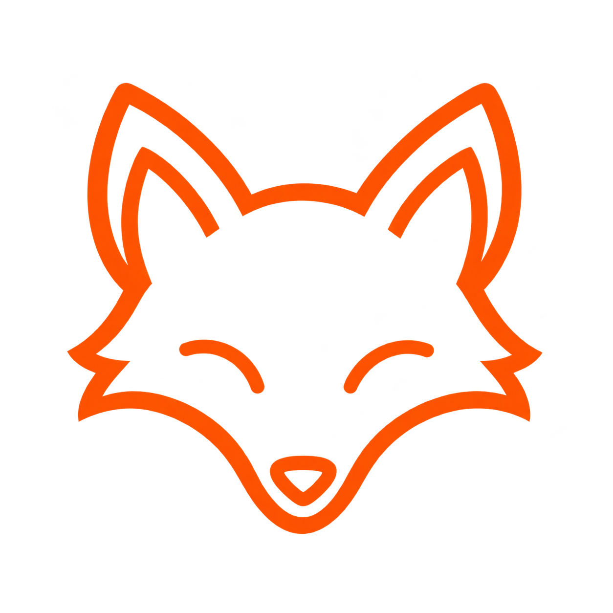
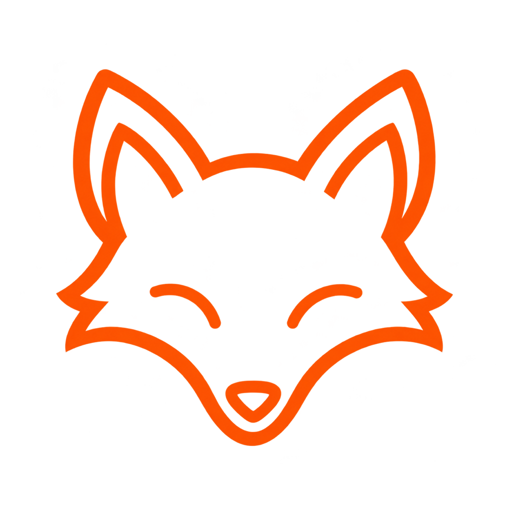
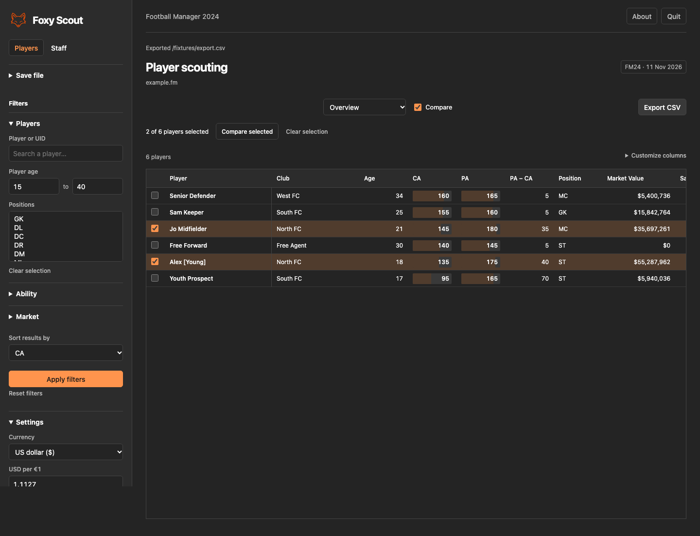
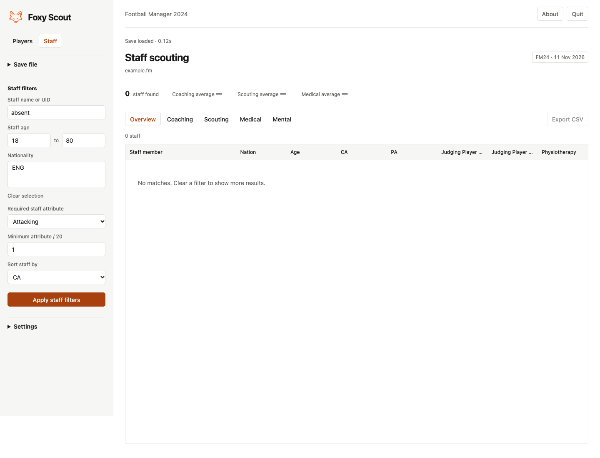

<p align="center"></p>
<h1 align="center">Foxy Scout</h1>
<p align="center">A fast, local scouting companion for Football Manager 2024.</p>
<p align="center"></p>

Foxy Scout reads an FM24 save on your computer and turns it into a searchable player and staff scouting workspace. The desktop app is built with Rust, Tauri, React and TypeScript.

## Screenshots





## Features

- Filter players by age, ability, position, role rating, nationality, club, contract and estimated price.
- Inspect player reports with attributes, positional familiarity, role ratings, contract details and value estimates.
- Compare up to six players across player attributes and contract information.
- Search staff and review coaching, scouting, medical and mental attributes.
- Display and export values in euros or US dollars. Edit the USD-per-euro rate in Settings.
- Customize CSV exports: all filtered rows or a row range, current table or all columns, comma/semicolon/tab separators, and optional headers. Review row and column counts before saving.
- Keep save files local. The reader does not modify saves.

## Currency

FM24 money values are decoded into a normalized USD amount. Settings can display and export euros using an editable exchange rate. The current parser does not extract a native euro denomination from a save; it uses the normalized values produced by the existing FM24 data model.

## Run from source

Install Node.js 20.19+ or 22.12+, Rust stable, and the [Tauri platform prerequisites](https://v2.tauri.app/start/prerequisites/).

```sh
export PATH="$HOME/.cargo/bin:$PATH"
npm ci
npm run tauri -- dev
```

Build the macOS desktop app:

```sh
./scripts/build_app.sh
```

## License

Football Manager is a trademark of Sports Interactive Limited. Foxy Scout is an unofficial fan project and is not affiliated with Sports Interactive or SEGA.
